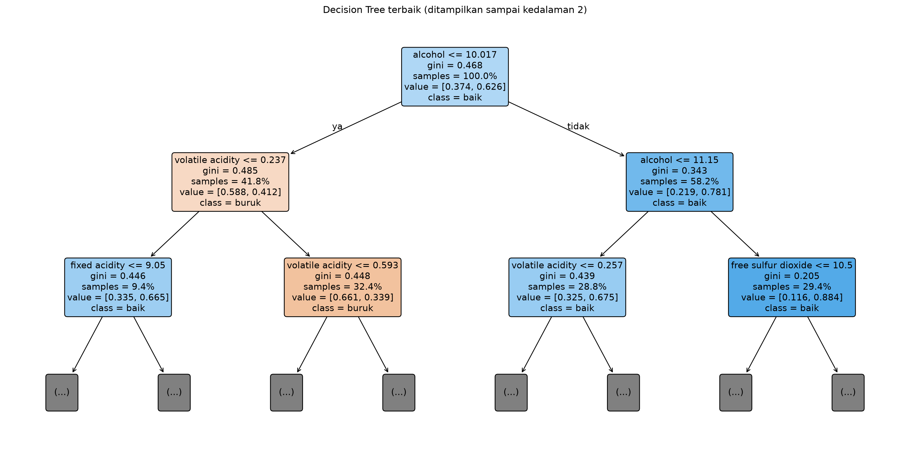

# ML5_23B — Decision Tree pada Dataset Wine Quality

Repositori tugas kelompok mata kuliah Machine Learning. Kombinasi algoritma yang dipakai adalah:

**Decision Tree (supervised) + Agglomerative Clustering (unsupervised) + ResNet18 (deep learning)**

| Algoritma | Dataset | Status |
|---|---|---|
| Decision Tree (klasifikasi) | Wine Quality | selesai |
| Decision Tree (regresi) | Wine Quality | selesai |
| Agglomerative Clustering | Wine Quality | dalam pengerjaan |
| ResNet18 | Imagenette 160px | dalam pengerjaan |

Repositori ini saat ini memuat pengerjaan lengkap bagian **Decision Tree** dalam dua varian CART: **classifier** (`quality >= 6`) dan **regressor** (skor `quality` 3–9), masing-masing dengan konsep, dasar matematis, simulasi manual, kode Python, serta visualisasi dan analisis.

---

## Struktur repositori

```text
.
├── data/
│   └── raw/
│       ├── winequality-red.csv
│       ├── winequality-white.csv
│       └── winequality.names
├── src/
│   └── supervised/
│       ├── simulasi_manual_dt.py     # simulasi Gini/IG (klasifikasi)
│       ├── decision_tree.py          # pipeline klasifikasi + visualisasi
│       ├── simulasi_manual_dtr.py    # simulasi MSE/variance reduction (regresi)
│       └── decision_tree_regresi.py  # pipeline regresi + visualisasi
├── results/
│   ├── figures/                      # 19 gambar hasil eksperimen
│   ├── metrics/                      # metrik, aturan pohon, hasil GridSearch
│   ├── models/                       # model terbaik (.joblib)
│   └── data/                         # sampel 8 baris untuk simulasi
├── reports/
│   ├── bagian3_simulasi_manual.md
│   ├── bagian4_implementasi_kode.md
│   ├── bagian5_visualisasi_analisis.md
│   └── bagian_dt_regresi.md
├── requirements.txt
└── README.md
```

---

## Dataset

### 1. Wine Quality (disertakan)

Dataset gabungan red dan white dari UCI Machine Learning Repository.

- Sumber: <https://archive.ics.uci.edu/dataset/186/wine+quality>
- Lisensi: CC BY 4.0
- Data mentah: 6.497 baris (1.599 red + 4.898 white), 11 fitur numerik
- Setelah 1.177 duplikat dibuang: **5.320 baris**
- Target klasifikasi: `quality ≥ 6` → baik (1), lainnya → buruk (0)
- Distribusi target biner: 3.332 baik (62,6%) dan 1.988 buruk (37,4%)
- Target regresi: skor `quality` asli 3–9 (mean 5,796; std 0,880)

File CSV memakai pemisah `;`.

### 2. Imagenette 160px (tidak disertakan)

Arsip berukuran ± 94 MB sehingga tidak dimasukkan ke repositori. Unduh lalu ekstrak secara manual:

```bash
# dari root repositori
mkdir -p data/raw
wget https://s3.amazonaws.com/fast-ai-imageclas/imagenette2-160.tgz -O data/raw/imagenette2-160.tgz
tar -xzf data/raw/imagenette2-160.tgz -C data/raw/
```

Struktur yang diharapkan: `data/raw/imagenette2-160/train/` dan `data/raw/imagenette2-160/val/`, masing-masing berisi 10 folder kelas.

---

## Instalasi

Disarankan memakai virtual environment:

```bash
python3 -m venv .venv
source .venv/bin/activate
pip install -r requirements.txt
```

Versi yang dipakai pada eksperimen:

| Komponen | Versi |
|---|---|
| Python | 3.14.8 |
| scikit-learn | 1.9.1 |
| pandas | 3.0.6 |
| NumPy | 2.5.4 |
| Matplotlib | 3.11.2 |
| joblib | 1.6.0 |

---

## Menjalankan

### Simulasi perhitungan manual

```bash
python3 src/supervised/simulasi_manual_dt.py
```

Menghitung Gini dan information gain untuk 8 baris data secara manual, lalu memverifikasinya terhadap `DecisionTreeClassifier(max_depth=2)`. Output: tabel perhitungan, `results/data/simulasi_dt_8baris.csv`, `results/metrics/simulasi_manual_dt.json`, dan `results/figures/dt_manual_tree.png`.

### Pipeline Decision Tree

```bash
python3 src/supervised/decision_tree.py
```

Alur: muat data → deduplikasi → target biner → split 80/20 stratified → baseline → GridSearchCV 5-fold → evaluasi test → 8 visualisasi. Waktu eksekusi ± 45 detik tanpa GPU.

### Simulasi manual regresi

```bash
python3 src/supervised/simulasi_manual_dtr.py
```

Menghitung MSE (variance), MSE terbobot, dan variance reduction untuk 8 baris data, lalu memverifikasinya terhadap `DecisionTreeRegressor(max_depth=2)`. Output: `results/data/simulasi_dtr_8baris.csv`, `results/metrics/simulasi_manual_dtr.json`, dan `results/figures/dtr_manual_tree.png`.

### Pipeline Decision Tree Regressor

```bash
python3 src/supervised/decision_tree_regresi.py
```

Alur: muat data → deduplikasi → target `quality` kontinu → split 80/20 → baseline (mean & linear) → dua GridSearchCV 5-fold (objective RMSE dan MAE) → evaluasi test → 9 visualisasi. Waktu eksekusi ± 40 detik tanpa GPU.

---

## Hasil utama — klasifikasi

Parameter terbaik hasil `GridSearchCV` (528 kombinasi × 5 fold, skor `f1_macro`):

```text
criterion        = gini
max_depth        = 9
min_samples_leaf = 1
ccp_alpha        = 0.001
class_weight     = None
```

Pohon akhir: kedalaman 9, 35 leaf. Performa pada 1.064 baris test:

| Model | Accuracy | Balanced acc. | F1 macro | ROC-AUC | PR-AUC |
|---|---:|---:|---:|---:|---:|
| Dummy (mayoritas) | 0,6259 | 0,5000 | 0,3850 | 0,5000 | 0,6259 |
| Decision Tree default | 0,6880 | 0,6648 | 0,6655 | 0,6648 | 0,7181 |
| **Decision Tree tuned** | **0,7331** | **0,7206** | **0,7180** | **0,7883** | **0,8512** |

Validasi silang 5-fold model terbaik: accuracy **0,7408 ± 0,0084**, F1 macro **0,7217 ± 0,0096**.

Fitur paling berpengaruh (permutation importance): `alcohol` (0,137), `volatile acidity` (0,052), `free sulfur dioxide` (0,023).

### Pohon keputusan



Gambar lengkap dan analisisnya ada di [`reports/bagian5_visualisasi_analisis.md`](reports/bagian5_visualisasi_analisis.md).

---

## Hasil utama — regresi

Target: skor `quality` asli (3–9). GridSearch 416 kombinasi × 5 fold, dua objective:

| Tuning | Parameter terbaik | CV |
|---|---|---|
| RMSE | `squared_error`, depth 7, leaf 50, α 0 | RMSE 0,7518 |
| MAE | `absolute_error`, depth 10, leaf 50, α 0,0005 | MAE 0,5204 |

Performa pada 1.064 baris test:

| Model | MAE | RMSE | R² | Prediksi ±1 poin |
|---|---:|---:|---:|---:|
| Dummy (rata-rata) | 0,6942 | 0,8676 | −0,0011 | 75,8% |
| Linear Regression | 0,5611 | 0,7244 | **0,3021** | 86,3% |
| Decision Tree default | 0,6626 | 0,9434 | −0,1838 | 89,8% |
| **Decision Tree tuned (RMSE)** | 0,5668 | **0,7330** | 0,2853 | 83,9% |
| Decision Tree tuned (MAE) | **0,5244** | 0,8065 | 0,1350 | **94,5%** |

Model utama: kedalaman 7, 51 leaf. CV 5-fold: RMSE **0,7518 ± 0,0155**, R² **0,2737 ± 0,0225**.

Fitur paling berpengaruh sama dengan klasifikasi: `alcohol` (permutation Δ RMSE 0,203), `volatile acidity` (0,050), `free sulfur dioxide` (0,040).


Analisis lengkap ada di [`reports/bagian_dt_regresi.md`](reports/bagian_dt_regresi.md).

---

## Metode ringkas

1. Data red dan white digabung, lalu **duplikat dibuang sebelum split** agar tidak terjadi kebocoran data.
2. Target klasifikasi dibinerkan dengan ambang `quality ≥ 6`; target regresi memakai skor asli 3–9.
3. Split 80/20 memakai `random_state=42`; klasifikasi memakai `stratify=y`, regresi memakai KFold.
4. Tidak ada scaling fitur karena Decision Tree tidak sensitif terhadap skala.
5. Klasifikasi dioptimalkan dengan `GridSearchCV` 5-fold dan skor `f1_macro` untuk mengatasi ketidakseimbangan kelas.
6. Regresi dioptimalkan dengan skor `neg_root_mean_squared_error` (utama) dan `neg_mean_absolute_error` (pembanding).
7. Evaluasi klasifikasi memakai accuracy, balanced accuracy, precision, recall, F1, F1 macro, ROC-AUC, PR-AUC, dan confusion matrix.
8. Evaluasi regresi memakai MAE, MSE, RMSE, R², median AE, MAPE, toleransi ±1 poin, dan akurasi ambang `quality ≥ 6`.

---

## Artefak hasil

| Lokasi | Isi |
|---|---|
| `results/figures/dt_*.png` | klasifikasi: distribusi kelas, pohon depth 2 dan 3, kurva `max_depth`, confusion matrix, ROC/PR, feature importance, learning curve |
| `results/figures/dtr_*.png` | regresi: distribusi quality, prediksi vs aktual, residual, distribusi prediksi, kurva `max_depth`, feature importance, learning curve, pohon depth 2 dan 3 |
| `results/figures/dtr_manual_tree.png` | pohon hasil simulasi manual regresi |
| `results/metrics/dt_metrics.json` | metrik klasifikasi dan parameter terbaik |
| `results/metrics/dtr_metrics.json` | metrik regresi, kedua objective, dan parameter terbaik |
| `results/metrics/dt_grid_top10.csv` | 10 konfigurasi terbaik GridSearch klasifikasi |
| `results/metrics/dtr_grid_top10.csv` | 10 konfigurasi terbaik GridSearch regresi (RMSE) |
| `results/metrics/dtr_grid_top10_mae.csv` | 10 konfigurasi terbaik GridSearch regresi (MAE) |
| `results/metrics/dt_rules_full.txt` | seluruh aturan pohon klasifikasi |
| `results/metrics/dtr_rules_full.txt` | seluruh aturan pohon regresi |
| `results/models/decision_tree_best.joblib` | model klasifikasi terbaik |
| `results/models/decision_tree_regresi_best.joblib` | model regresi terbaik |
| `results/data/simulasi_dt_8baris.csv` | data simulasi manual klasifikasi |
| `results/data/simulasi_dtr_8baris.csv` | data simulasi manual regresi |

---

## Tim

| Nama | NIM | Bagian |
|---|---|---|
| _(isi nama)_ | _(isi NIM)_ | Decision Tree |
| _(isi nama)_ | _(isi NIM)_ | Agglomerative Clustering |
| _(isi nama)_ | _(isi NIM)_ | ResNet18 |
| _(isi nama)_ | _(isi NIM)_ | Integrasi laporan |

---

## Lisensi dan sumber

Kode dalam repositori ini dibuat untuk keperluan akademik. Dataset mengikuti lisensi masing-masing:

- Wine Quality — UCI Machine Learning Repository, CC BY 4.0
- Imagenette — Jeremy Howard / fast.ai, diturunkan dari ImageNet
